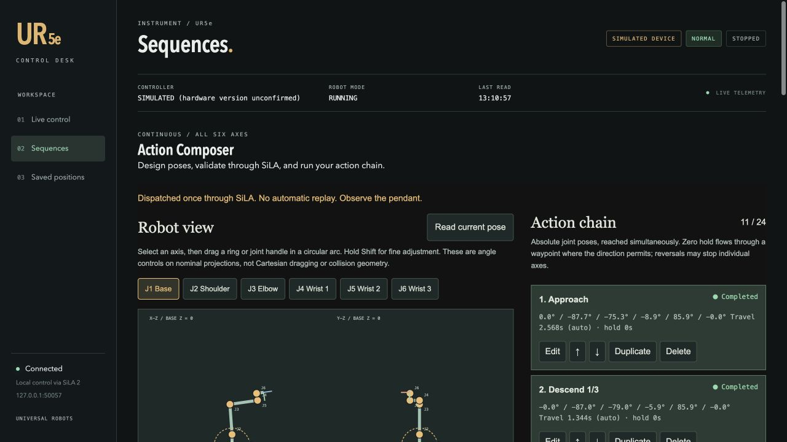
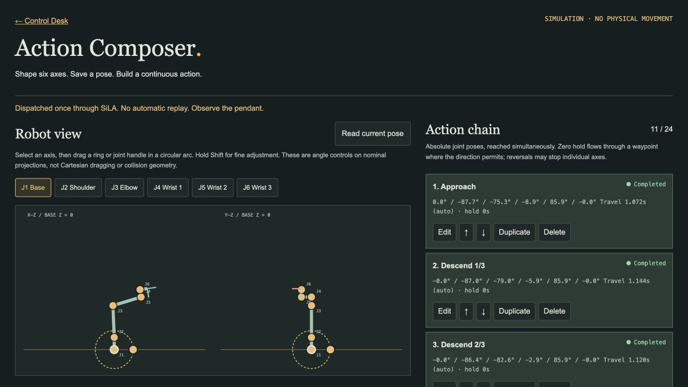

# UR5e SiLA Connector

Control a Universal Robots UR5e through **SiLA 2**, with an English browser Control Desk and a visual **Action Composer**. Run the same Python connector on macOS, Linux or native Windows using the UniteLabs CDK.

Design a continuous six-axis action chain in the browser, validate it through SiLA, and inspect execution progress and trajectory data. Start with the simulated device before connecting a robot.

**Real motion is disabled in every shipped configuration.** Opening the UI does not start movement. This development connector is not a certified robot safety system.

## Action Composer

Open **Control Desk → 02 Sequences** to build and run an action chain without writing URScript.



- Rotate individual joints using projected handles, a rotary dial or numeric angles. Save, reorder and duplicate six-axis waypoint poses.
- Set one motion speed. The connector calculates travel times from the speed and acceleration limits; zero-hold waypoints allow continuous motion where direction permits.
- Validate and preview the complete chain through SiLA before an explicit one-time run.
- Request **Stop all** or **Pause after action** when needed. After a pause, edit the remaining actions, validate again and explicitly continue.
- Follow the active action's green indicator and completed cards. Export planned and measured or simulated trajectories as an episode dataset.
- Teach a fixed target or use nominal TCP/IK to prepare an approach, descent, simulated grasp, lift and retreat. Save reusable tasks or import/export action chains as JSON.



Both screenshots show simulation. Nominal geometry and kinematic previews do not validate collisions, calibrated positioning or robot dynamics. Controller feedback execution has a separate real-hardware qualification gate, disabled by default. See [Action Composer](docs/ACTION_COMPOSER.md) and [Task workflows](docs/TASK_WORKFLOWS.md).

## Quick start: no robot required

**Windows users: start with the complete [Windows guide](docs/WINDOWS.md).** It includes PowerShell 7.4+ installation, equivalent launch commands, Ethernet setup, persistent paths, and the first-workstation acceptance checklist. Windows CI is separate from physical Windows-to-robot acceptance, which remains pending.

The commands below are for macOS/Linux. Prerequisites: Git, [uv](https://docs.astral.sh/uv/getting-started/installation/), and Python 3.12. The setup command can use uv's managed Python installation. Python 3.12 on macOS is the physical development baseline; other controller and host versions need their own validation.

```bash
git clone https://github.com/SissiFeng/ur5e-sila-connector.git
cd ur5e-sila-connector
bash scripts/setup.sh
```

Keep each long-running service in its own terminal. Run all commands from the repository root.

**Terminal 1 — simulated SiLA connector:**

```bash
bash scripts/run.sh python -m unitelabs.ur5e_connector --config-path simulation.example.json
```

**Terminal 2 — English control desk:**

```bash
bash scripts/run.sh python -m unitelabs.ur5e_connector.ui.server --simulation --port 8766
```

Open **http://127.0.0.1:8766/#sequences**. Confirm **SIMULATED DEVICE** in the header. In Action Composer:

1. Choose **Read current pose** to capture the simulated start.
2. Use **Import JSON** to load [the example action chain](examples/action-chain.simulation.json), or adjust the six joint angles and add your own waypoints.
3. Set **Motion speed (°/s)**, then **Validate via SiLA**.
4. Choose **Play validated preview** to inspect the path, then **Run once via SiLA · simulation**.
5. Follow the action cards to completion and choose **Export run dataset** to save the episode.

This setup does not connect to physical hardware. Expand **Stepped routines & saved-position sequences** below the composer to use the earlier joint presets and their separate speed/preview controls.

**Terminal 3 — optional network smoke test:**

```bash
bash scripts/run.sh python examples/demo_client.py --port 50052
bash scripts/run.sh python examples/validate_continuous.py
```

The first example exercises program states through real SiLA network calls to the simulated device. The second validates a continuous dance and explicit return to a captured reference in accelerated kinematic simulation. Neither validates robot dynamics or collision clearance.

## Guides

| Task | Guide |
| --- | --- |
| Install and run on native Windows with PowerShell | [Windows guide](docs/WINDOWS.md) |
| Design continuous six-axis action chains | [Action Composer](docs/ACTION_COMPOSER.md) |
| Teach TCP targets, rehearse pickup, pause/continue and export episodes | [Task workflows](docs/TASK_WORKFLOWS.md) |
| Operate the English UI, presets, speed, and saved poses | [UI guide](docs/UI_GUIDE.md) |
| Connect Ethernet, start read-only mode, authorize motion, shut down | [Hardware setup](docs/HARDWARE.md) |
| Understand commands, request IDs, receipts, and data storage | [SiLA and architecture](docs/ARCHITECTURE.md) |
| Record all six measured joint trajectories | [Trajectory recording](docs/RECORDING.md) |
| Diagnose connection, limits, timeouts, or missing motion | [Troubleshooting](docs/TROUBLESHOOTING.md) |
| Review what was actually tested and what remains open | [Validation and handoff](docs/VALIDATION.md) |
| Run tests and contribute | [Contributing](CONTRIBUTING.md) |

## What is supported

| Capability | Status |
| --- | --- |
| Simulation through the same SiLA feature | Implemented; automated tests |
| Dashboard version, robot mode, safety status, program state | Implemented; real UR5e observations |
| Joint positions and TCP readings | Output-only RTDE |
| Bounded single-joint moves and stepped UI sequences | Implemented; measured real Showreel evidence |
| Six-axis Showreel | **Sequential axes**, each excursion returns; not simultaneous motion |
| Action Composer | Continuous six-axis waypoint chains, automatic timing, SiLA validation and simulation execution |
| Optional Stop/Pause and action progress | Simulation verified; new controller feedback program awaits physical qualification |
| Task library and episode export | Persistent tasks, teaching provenance, planned and measured/simulated trajectories |
| Return to reference | Explicit prepared trajectory; not an automatic move to zero |
| Fixed-location pickup rehearsal | Nominal TCP/IK and taught targets; no gripper actuation or collision validation |
| Native Windows | PowerShell setup and shared Python/UI implementation; physical Windows-to-robot acceptance pending |

The development robot was a UR5e running URSoftware **5.4.2.76197**. This does not establish compatibility with every UR firmware version. Remote Control must be confirmed at the pendant; the 5.4 integration does not query that switch.

## Speed is not a promise of measured speed

Jog and stepped command speeds range from 1–40 degrees per second. The pendant slider also scales motion. At a 30 degrees/second command with a 28% slider, the nominal scaled cap is 8.4 degrees/second; the recorded Showreel peak was about 7.46 degrees/second. Acceleration and short moves reduce the achieved peak further. The connector never automatically raises the pendant slider.

Action Composer also accepts 1–40 degrees/second and calculates travel time for the authored path. You do not need to enter a separate travel time for each action. Acceleration limits, reversals, holds and the pendant slider affect the achieved speed. Stepped routines use their own speed slider. The older Flow Dance API remains available for compatibility; the Sequences page now uses Action Composer.

## Data and defaults

SiLA and HTTP listen on loopback. The panel uses a same-origin session token for changes. Do not expose these TLS-disabled development endpoints to the network.

The wrapper scripts keep the environment, bytecode, and runtime data outside the checkout. On macOS, runtime data defaults to `~/Library/Application Support/UR5eConnector/<project-id>/`; on Windows it defaults to `%LOCALAPPDATA%\UR5eConnector\<checkout-id>\data`. The ID depends on the checkout path. Use a stable `UR5E_DATA_DIR` when relocating an existing installation. Preserve receipts and panel history together; do not start with an empty receipt directory to bypass an unresolved command.

This repository excludes site IP addresses, authorization files, raw operational logs, and local runtime histories. The sanitized [hardware evidence summary](evidence/showreel-2026-10-20.json) reports measured results without publishing the original operator's recordings.

## Vendor references

- [UniteLabs connector development installation](https://docs.unitelabs.io/connector-development/getting-started/installation/)
- [Universal Robots Dashboard Server, e-Series, port 29999](https://www.universal-robots.com/articles/ur/dashboard-server-e-series-port-29999/)

This project is independently developed and is not an official Universal Robots product. Dependency and template licenses remain with their respective owners. No additional distribution license is granted by this repository at present.


## Moving this repository to an organization

After transferring the repository, use the organization's clone URL in place of the owner URL in these guides. Existing users can update their checkout with `git remote set-url origin <new-repository-url>`. Documentation and screenshot links use relative paths and move with the repository. Keep the local runtime-data directory and motion receipts when relocating a checkout. Review organization access, Actions settings and the distribution-license decision before sharing more widely.
