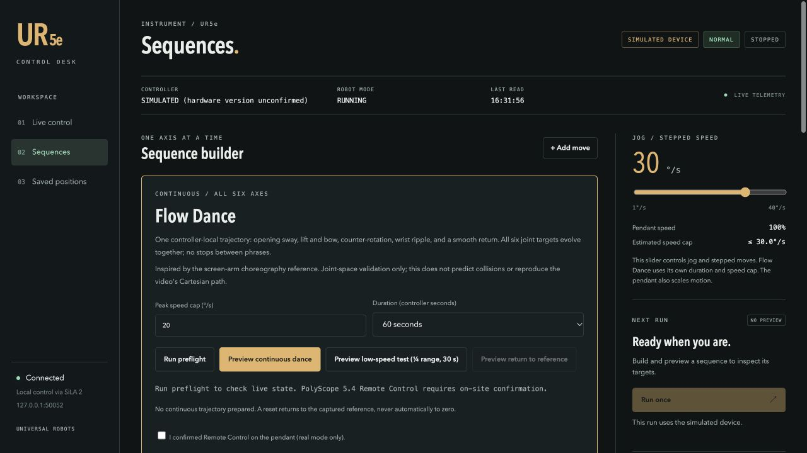

# UR5e SiLA Connector

A host-based Universal Robots UR5e connector built with the UniteLabs CDK and SiLA 2. Includes an English browser control desk, a simulated device, read-only robot status, bounded joint commands, stepped sequences, and experimental continuous choreography. macOS/Linux use Bash scripts; native Windows uses PowerShell scripts with the same Python package and UI.

**Start in simulation. Real motion is disabled in every shipped configuration.** Opening the UI never starts movement. This repository is a development connector, not a certified robot safety system.



## Quick start: no robot required

**Windows users: start with the complete [Windows guide](docs/WINDOWS.md).** It includes PowerShell 7.4+ installation, equivalent launch commands, Ethernet setup, persistent paths, and the first-workstation acceptance checklist. Windows CI is separate from physical Windows-to-robot acceptance, which remains pending.

The commands below are for macOS/Linux. Prerequisites: Git, [uv](https://docs.astral.sh/uv/getting-started/installation/), and Python 3.12. The setup command can use uv's managed Python installation. Python 3.12 on macOS is the physical development baseline; other controller and host versions need their own validation.

```bash
git clone https://github.com/SissiFeng/ur5e-sila-connector.git
cd ur5e-sila-connector
bash scripts/setup.sh
```

Keep each long-running service in its own terminal. Run all commands from the repository root.

**Terminal 1 — simulated SiLA connector:**

```bash
bash scripts/run.sh python -m unitelabs.ur5e_connector --config-path simulation.example.json
```

**Terminal 2 — English control desk:**

```bash
bash scripts/run.sh python -m unitelabs.ur5e_connector.ui.server --simulation --port 8766
```

Open **http://127.0.0.1:8766/**. The header must say **SIMULATED DEVICE**. Choose **Sequences**, load a preset, preview its targets, and click **Run once**. No physical robot is connected by this setup.

**Terminal 3 — optional network smoke test:**

```bash
bash scripts/run.sh python examples/demo_client.py --port 50052
bash scripts/run.sh python examples/validate_continuous.py
```

The first example exercises program states through real SiLA network calls to the simulated device. The second validates a continuous dance and explicit return to a captured reference in accelerated kinematic simulation. Neither validates robot dynamics or collision clearance.

## Guides

| Task | Guide |
| --- | --- |
| Install and run on native Windows with PowerShell | [Windows guide](docs/WINDOWS.md) |
| Operate the English UI, presets, speed, and saved poses | [UI guide](docs/UI_GUIDE.md) |
| Connect Ethernet, start read-only mode, authorize motion, shut down | [Hardware setup](docs/HARDWARE.md) |
| Understand commands, request IDs, receipts, and data storage | [SiLA and architecture](docs/ARCHITECTURE.md) |
| Record all six measured joint trajectories | [Trajectory recording](docs/RECORDING.md) |
| Diagnose connection, limits, timeouts, or missing motion | [Troubleshooting](docs/TROUBLESHOOTING.md) |
| Review what was actually tested and what remains open | [Validation and handoff](docs/VALIDATION.md) |
| Run tests and contribute | [Contributing](CONTRIBUTING.md) |

## What is supported

| Capability | Status |
| --- | --- |
| Simulation through the same SiLA feature | Implemented; automated tests |
| Dashboard version, robot mode, safety status, program state | Implemented; real UR5e observations |
| Joint positions and TCP readings | Output-only RTDE |
| Bounded single-joint moves and stepped UI sequences | Implemented; measured real Showreel evidence |
| Six-axis Showreel | **Sequential axes**, each excursion returns; not simultaneous motion |
| Flow Dance | Continuous multi-axis setpoints; simulation verified; visible physical acceptance remains open |
| Return to reference | Explicit prepared trajectory; not an automatic move to zero |
| Fixed-point approach/target/retreat | Stored joint poses; no Cartesian planning or gripper actuation |

The development robot was a UR5e running URSoftware **5.4.2.76197**. This does not establish compatibility with every UR firmware version. Remote Control must be confirmed at the pendant; the 5.4 integration does not query that switch.

## Speed is not a promise of measured speed

Jog and stepped command speeds range from 1–40 degrees per second. The pendant slider also scales motion. At a 30 degrees/second command with a 28% slider, the nominal scaled cap is 8.4 degrees/second; the recorded Showreel peak was about 7.46 degrees/second. Acceleration and short moves reduce the achieved peak further. The connector never automatically raises the pendant slider.

Flow Dance has a separate speed cap and duration. Increasing its cap does not shorten a fixed-duration curve. The low-speed preview uses one-quarter amplitude and a 3 degrees/second cap.

## Data and defaults

SiLA and HTTP listen on loopback. The panel uses a same-origin session token for changes. Do not expose these TLS-disabled development endpoints to the network.

The wrapper scripts keep the environment, bytecode, and runtime data outside the checkout. On macOS, runtime data defaults to `~/Library/Application Support/UR5eConnector/<project-id>/`; on Windows it defaults to `%LOCALAPPDATA%\UR5eConnector\<checkout-id>\data`. The ID depends on the checkout path. Use a stable `UR5E_DATA_DIR` when relocating an existing installation. Preserve receipts and panel history together; do not start with an empty receipt directory to bypass an unresolved command.

This repository excludes site IP addresses, authorization files, raw operational logs, and local runtime histories. The sanitized [hardware evidence summary](evidence/showreel-2026-10-20.json) reports measured results without publishing the original operator's recordings.

## Vendor references

- [UniteLabs connector development installation](https://docs.unitelabs.io/connector-development/getting-started/installation/)
- [Universal Robots Dashboard Server, e-Series, port 29999](https://www.universal-robots.com/articles/ur/dashboard-server-e-series-port-29999/)

This project is independently developed and is not an official Universal Robots product. Dependency and template licenses remain with their respective owners. No additional distribution license is granted by this repository at present.
